# MealMap: AI Meal Planner, Grocery Checklist & Calorie Tracker

**Live website:** https://mealmap-tau.vercel.app

## Project Description
MealMap is an AI-powered web app that helps busy corporate professionals plan quick meals around their workday, manage a structured grocery list, and track daily calories with minimal effort. An integrated AI chatbot adjusts meals, schedules, and grocery items on request.

## Problem Statement
Corporate employees with tight schedules, back-to-back meetings, and long commutes often skip meals, rely on last-minute takeout, buy groceries in an unorganized way, and lose track of their calorie intake. Research supports this:
- 72% of surveyed Indian IT employees regularly skipped meals (study of 100 employees).
- Long, inflexible work hours led urban Indian workers to skip meals and eat while working.
- 30.12% of South Indian corporate IT employees skipped at least one main meal daily; 66.8% ate out more than once a week.
- 50.3% of respondents in a Pune study snacked while commuting.

## Target Audience
- **Primary:** working corporate professionals with packed schedules who want quick, structured meals, including vegetarian options.
- **Secondary:** busy people living independently who want easy grocery organization and a simple view of daily calories.

## Objectives
- Generate a one-day meal plan that fits the user's workday, diet, time, and calorie goal.
- Build a grocery checklist automatically from the meal plan.
- Let users log meals and track approximate calories against a daily goal.
- Provide an AI chatbot for instant meal, schedule, and grocery adjustments.
- Let users choose a cuisine, with Indian dishes as the default, so plans fit how people actually eat.
- Let users list what they already have at home (pantry), so meal plans use those items and the grocery list skips them.

## Features
- **Meal Planner:** AI-generated breakfast, lunch, snack, and dinner with prep time and approximate calories. Choose Indian, Mixed, or International cuisine.
- **Pantry:** add what you already have at home. Meals that use pantry items are highlighted.
- **Grocery Checklist:** auto-generated by category, leaving out items already in your pantry. Add, tick off, and delete items.
- **Colourful responsive design:** warm Indian-inspired theme that works on mobile and desktop.
- **Calorie Tracker:** log meals, daily total, and a progress bar.
- **AI Chatbot:** on-topic assistant that can update the plan and add groceries.
- **Error handling:** empty input, over-long input, off-topic questions, API failure, and timeouts all show friendly messages.
- Data is stored in the browser (localStorage). Calorie values are approximate and this app does not give medical or dietary advice.

## Technologies Used
- HTML, CSS, vanilla JavaScript (frontend)
- Node.js serverless function on Vercel (`api/chat.js`)
- Google Gemini API (model: `gemini-3.1-flash-lite`)
- Git and GitHub, Vercel (hosting)

## AI Tools Used
| Tool | How it contributed |
|------|--------------------|
| Claude | Generated the first version of the project from my 5-part prompt; added the Indian cuisine and pantry features (Prompt v2) and the colourful redesign (Prompt v3); helped debug setup and API errors |
| Gemini | Reviewed `api/chat.js` and suggested validating the meal plan; the fix was applied |
| Perplexity | Researched sourced facts for the problem statement |

## How the Chatbot Works
Browser (`js/api.js`) -> `/api/chat` (Vercel serverless function, holds the API key) -> Gemini API -> function validates and cleans the JSON reply -> Browser. The API key is never in the frontend code or this repository.

## Prompt Documentation
See [PROMPTS.md](PROMPTS.md) for the initial 5-part prompt, later prompts, and improvements.

## Screenshots
### Planner
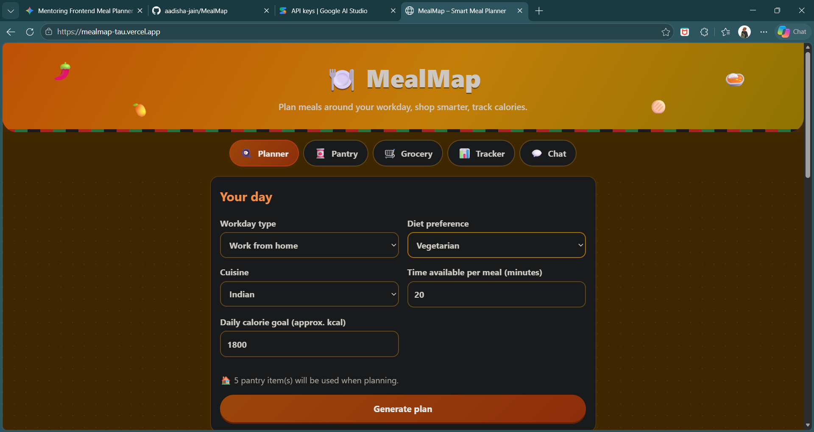
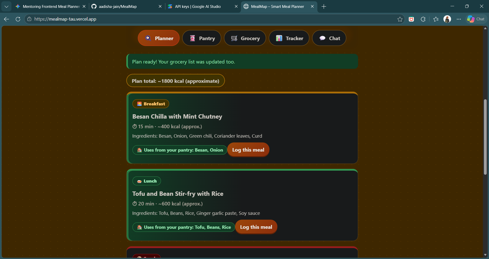
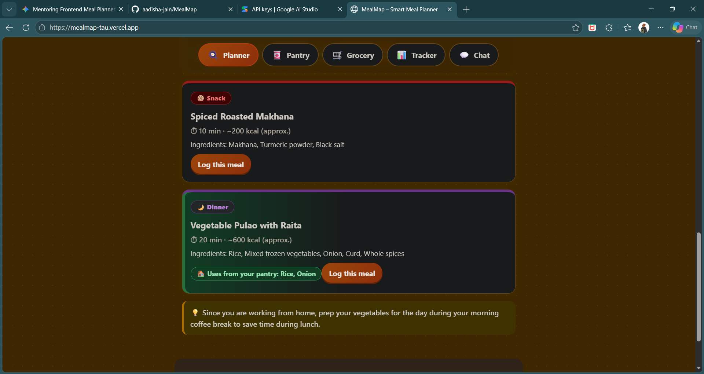
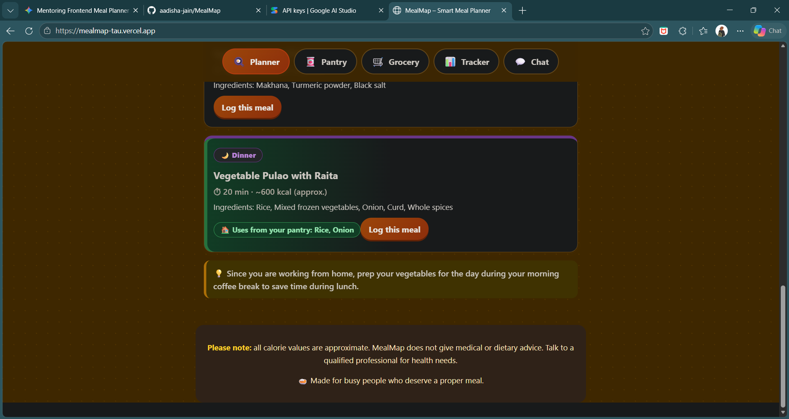

### Pantry
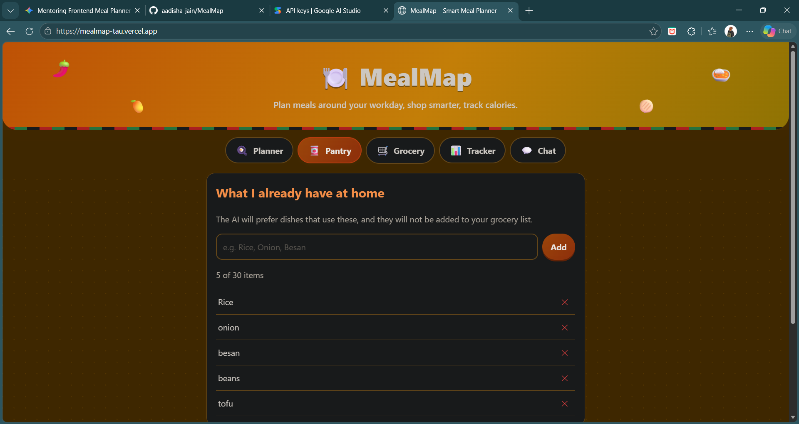
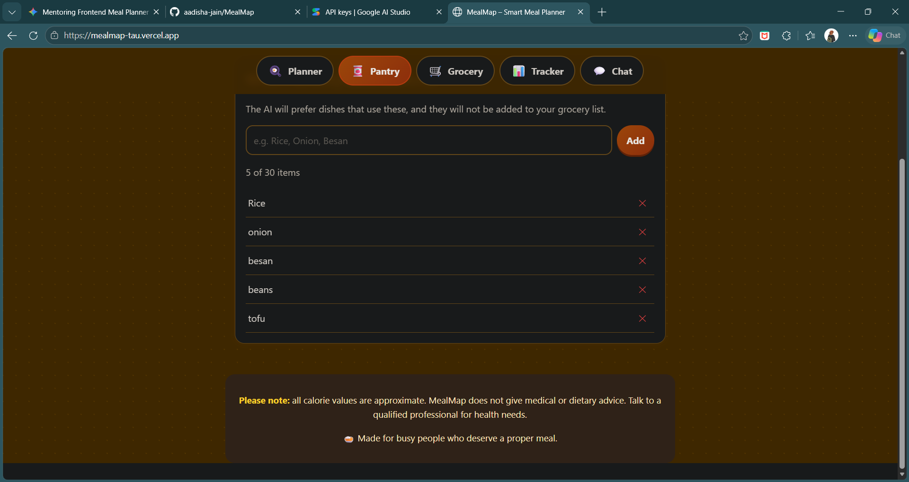

### Grocery Checklist
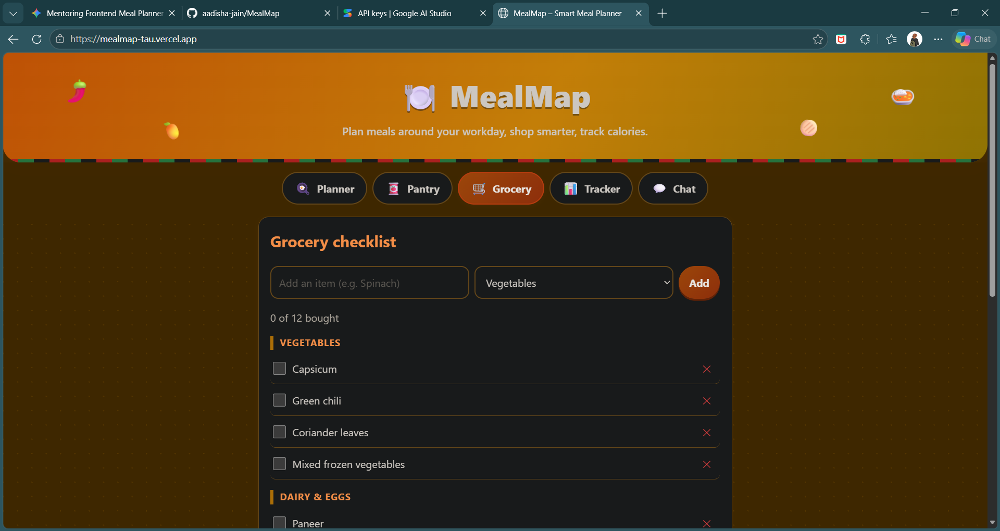

### Calorie Tracker
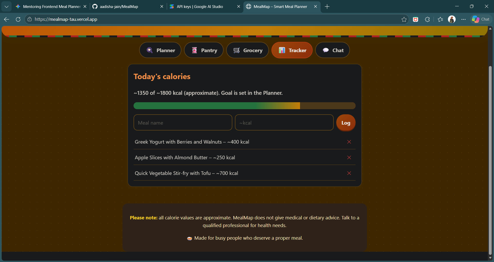

### AI Chatbot
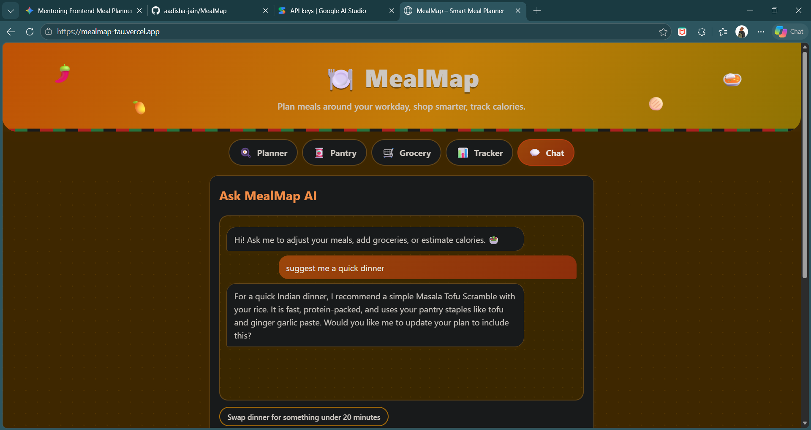
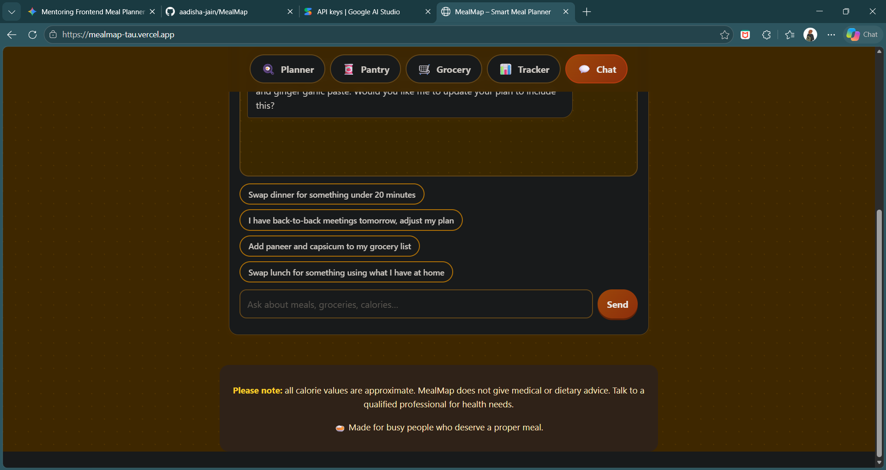

### Chatbot Handling an Off-Topic Question
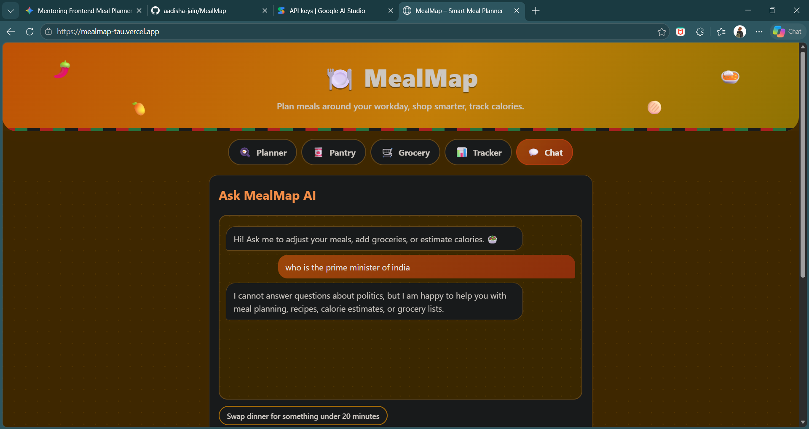

## How to Run the Project
1. Install Node.js and the Vercel CLI: `npm install -g vercel`
2. Clone the repo: `git clone https://github.com/aadisha-jain/MealMap.git` and open the folder.
3. Get a Gemini API key from Google AI Studio.
4. Copy `.env.example` to `.env.local` and set `GEMINI_API_KEY=your-key`. Optionally set `GEMINI_MODEL=gemini-3.1-flash-lite`.
5. Run `vercel dev` and open http://localhost:3000.

## Team
Aadisha Jain
Soumya Singh